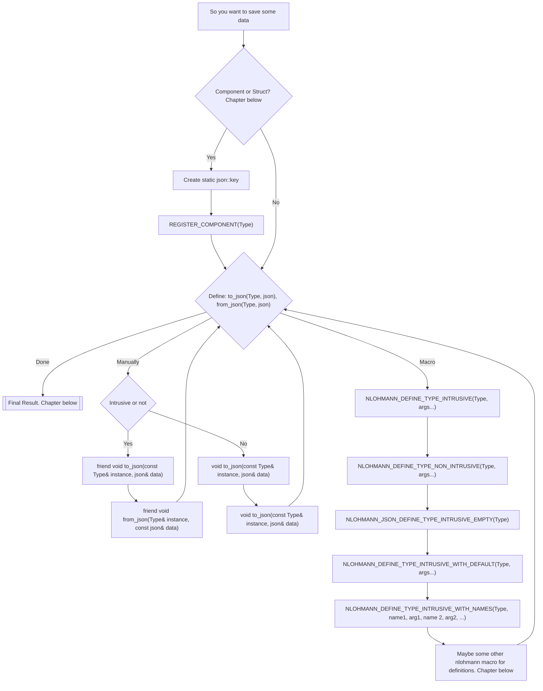

# How to create a component and save it?



## Component or Struct?

Components are unique to an entity, and they are used by some system directly.

For example, a `Position` is a component, because it refers to **THE** position of the entity, and it is used by a `MovementSystem` so as to change the entity's position. On the contrary, a `Vector` is not a component, there are many vectors for an entity, it may be its position, target, direction,  size, etc. It is also not immedietly affected by a system of the game (there will be nothing looking for it specifically). Try to fill the sentence: `This system need to handle/change/react to the X of the entity`, if it works probably a component, if not, then it is a struct

## REGISTER_COMPONENT

`REGISTER_COMPONENT` is a macro that will registry the type to the singleton instance of `DataManager` for the save/load system. It requires that the type is both `HasJsonKey`, which requires access to a static member `json_key` that return `std::string`, and `JsonCompatible`, which requires access to the global functions `to_json()` and `from_json()` of the relevent type.

If any error arrise from the use of this macro, check 3 thing:
- Is `Type::json_key` a `std::string`?
- Did you define (manually or with macro) `friend void to_json(const Type& object, nlohmann::json& data)` and ` friend void from_json(Type& object, const nlohmann:json& data)`?
-  Did you register from outside the scope of the type?

## Final Component

```
struct AroundAPoint{
    static constexpr std::string json_key = "AroundAPoint";

    Point p;
    float r;
    float angle;

    NLOHMANN_DEFINE_TYPE_INTRUSIVE(AroundAPoint, p, r, angle);
};
REGISTER_COMPONENT(AroundAPoint);
```

## nlohmann Macros

`nlohmann::json` includes **MANY** types of macros for automatic definition of the `to_json()` and `from_json()`. The main types that we used are `NLOHMANN_DEFINE_TYPE_INTRUSIVE` and `NLOHMANN_JSON_DEFINE_TYPE_INTRUSIVE_EMPTY`
but if you feel like there is need for a special case, look at the [link here](https://json.nlohmann.me/features/arbitrary_types/#simplify-your-life-with-macros) for more macros. If no macro is exactly what you look for, time to manually write the functions